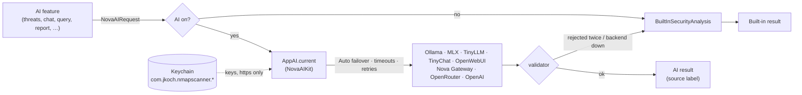
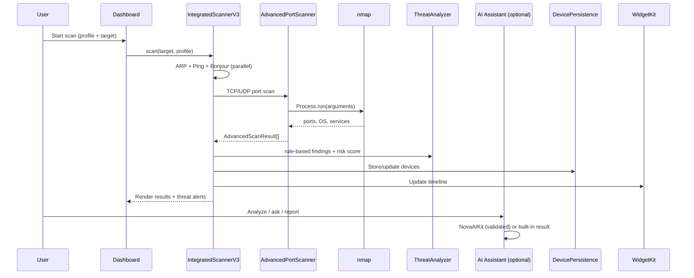

# NMAPScanner

A native macOS network security scanner that wraps nmap in a modern SwiftUI interface: network discovery, threat detection, device management, UniFi controller integration, compliance reporting, a local REST API — and optional AI analysis through [NovaAIKit](https://github.com/kochj23/NovaAIKit) with a built-in rule-based fallback for every AI feature.


---

## Features

| Feature | Description |
|---------|-------------|
| Network discovery | ARP, ping, Bonjour, and nmap-based host detection with 115 ports scanned in parallel |
| 6 scan profiles | Quick, Standard, Comprehensive, Aggressive, Stealth, and Custom nmap configurations |
| OS and service detection | nmap OS fingerprinting, service version probes, and banner grabbing |
| Rule-based threat analysis | Backdoor / remote-access / database port rules, rogue-device detection, risk scoring — always on, no AI needed |
| AI Assistant (optional) | Threat analysis, device classification, security chat, natural-language device search, anomaly detection, recommendations, network documentation and a 4-section security report — via any NovaAIKit backend, each with a built-in fallback |
| Shadow AI detection | Finds unauthorized LLM/AI services (Ollama, ComfyUI, …) running on your network |
| Vulnerability scanning | CVE cross-referencing, SSL/TLS certificate grading, DNS security analysis, insecure port detection, malware port pattern matching |
| Compliance reporting | Validation against NIST, CIS, PCI-DSS, HIPAA, SOC 2, and ISO 27001 frameworks |
| Device management | Whitelist, block (pfctl), deep scan, VLAN isolation (UniFi), reputation scoring, uptime tracking, grouping |
| UniFi integration | Authenticate to UniFi OS controllers, list clients, identify Protect cameras, create firewall rules and VLAN assignments |
| Export formats | PDF, CSV, JSON, HTML, Markdown, and STIX 2.1 threat intelligence bundles |
| 8-tab navigation | Dashboard, Security and Traffic, AI Assistant, Network Tools, Topology Graph, HomeKit, WiFi Networks, Dependency Graph |
| Menu bar agent | Persistent status icon with quick scan, device list, and threat count |
| Desktop widgets | WidgetKit extension (Small / Medium / Large) showing security score, device counts, and scan schedule |
| Scheduled scans | Configurable intervals with scan history and watchdog |
| Nova API server | REST API on port 37423 (loopback only) for automation |

---

## AI

NMAPScanner's AI runs on **[NovaAIKit 1.0](https://github.com/kochj23/NovaAIKit)** — the same AI feature set as every other Nova macOS app. The app has no AI client code of its own.

| | |
|---|---|
| **On/off** | Settings › AI › *Use AI* (also AI Assistant › AI Settings). Off = nothing is sent anywhere; every feature uses its built-in result. |
| **Backends** | Auto (failover in order), Ollama, MLX (Apple Silicon, `mlx_lm.server`), TinyLLM, TinyChat, OpenWebUI, Nova Gateway / fleet, OpenRouter, OpenAI. Model picker and editable URL per backend, configurable timeout, *Test connection*. |
| **Keys** | Only in the macOS Keychain under `com.jkoch.nmapscanner.<backend>` (account `apiKey`). Shown as “stored”, never as text. Keys are only ever sent over https. |
| **Status** | `NovaAIStatusIndicator` in the AI Assistant header and the Security Report header: green = online, orange = unreachable, grey = off. Click to re-check. |
| **Reliability** | Auto failover across backends, per-request timeouts, retries with back-off, and output validation (a rejected reply is re-asked once with the reason, then the built-in result is used). |

### Fallback per feature

| Feature | AI validator | Built-in result when AI is off / down / rejected |
|---|---|---|
| Threat analysis (network) | non-empty, ≥ 20 chars, `<think>` stripped, length cap | `ThreatAnalyzer` findings: severity counts, per-host threats, remediations |
| Device risk | must state Critical/High/Medium/Low/Safe | worst rule-based finding for the device |
| Device classification | `Type:` line required; every field length-clamped and plain text | existing detection (hostname, MAC vendor, ports), confidence Low |
| Security assistant (chat) | streamed; empty reply rejected | the reason AI is unavailable + the built-in analysis summary and top actions |
| Natural-language query | `Matches:` may only name devices that exist | keyword search over name, IP, MAC, vendor, type, OS, services, ports (`rogue`, `risky`, `online` understood) |
| Anomaly detection | `Suspicious/Concerning: Yes/No` + known severity | heuristic anomalies: new device (critical with a backdoor port), unusual port count, missing devices |
| Security recommendations | at least one parsed recommendation; device form needs `Title:`/`Priority:` | grouped rule-based remediations by priority |
| Network documentation | Markdown heading required | template document: summary, topology, inventory table, findings, recommendations |
| Security report (4 sections) | per section | each section lists the underlying scan data; footer says how many sections came from AI |

### Migration from the old AI layer (9.1.0)

On first launch the old `AIBackendManager` settings are imported once (backend, Ollama model, TinyLLM / TinyChat / OpenWebUI / Nova Gateway URLs, OpenRouter model). A plaintext OpenAI key left in UserDefaults by older builds is moved into the Keychain and removed from UserDefaults; leftover Google Cloud / Azure / AWS / IBM Watson secrets and the old prompt log are deleted (**security fix**). The OpenRouter key already lived at `com.jkoch.nmapscanner.openrouter`, so it carries over unchanged. Google / Azure / AWS / IBM backends, the Python-MLX detector and the app's own load balancer were removed.



---

## Architecture

```mermaid
graph TD
    subgraph UI["SwiftUI Frontend (8 Tabs)"]
        DASH[Dashboard V3]
        SEC[Security and Traffic]
        AIUI["AI Assistant<br/>+ NovaAIStatusIndicator"]
        TOOLS[Network Tools<br/>Ping / Traceroute / DNS / ARP / Config]
        TOPO[Topology Graph]
        HK[HomeKit Tab]
        WIFI[WiFi Networks]
        DEP[Dependency Graph]
        MENU[MenuBarAgent]
        SET["Settings window<br/>General · Scanning · Network · Alerts · Grouping · Advanced · AI"]
    end

    subgraph Engine["Scan Engine"]
        ISV3[IntegratedScannerV3]
        ISV3 --> APS[AdvancedPortScanner]
        ISV3 --> PING[PingScanner]
        ISV3 --> BONJ[BonjourScanner]
        ISV3 --> ARP[ARPScanner]
        APS -->|Process.arguments| NMAP["nmap"]
        NMAP --> PARSER[Output Parser]
        PARSER --> RESULT["AdvancedScanResult<br/>(ports, OS, services)"]
    end

    subgraph AI["AI Features (NovaAIKit)"]
        APPAI["AppAI<br/>one NovaAI · validators · legacy migration"]
        FEAT["MLXThreatAnalyzer · MLXDeviceClassifier · MLXSecurityAssistant<br/>MLXQueryInterface · MLXAnomalyDetector · MLXSecurityRecommendations<br/>MLXDocumentationGenerator · LLMSecurityReportGenerator"]
        BUILTIN[BuiltInSecurityAnalysis]
        FEAT --> APPAI
        FEAT --> BUILTIN
        APPAI --> KIT["NovaAIKit 1.0<br/>9 backends · failover · Keychain"]
    end

    subgraph Security["Security Subsystem"]
        TA[ThreatAnalyzer]
        VULN[VulnerabilityScanner]
        SSL[SSLCertificateAnalyzer]
        DNS_SEC[DNSSecurityAnalyzer]
        INSECURE[InsecurePortDetector]
        MALWARE[MalwarePatternDetector]
        IOT[IoTSecurityScorer]
        SHADOW[ShadowAIDetector]
        COMPLIANCE["ComplianceFramework<br/>NIST / CIS / PCI / HIPAA / SOC2 / ISO27001"]
    end

    subgraph Integration["Integration Layer"]
        UNIFI[UniFiController] --> KEYCHAIN[macOS Keychain]
        NOVA["NovaAPIServer :37423"]
        EXPORT[ExportManager] --> FORMATS["PDF / CSV / JSON / HTML / STIX 2.1"]
        DEVICE[DevicePersistence]
        SCHED[ScheduledScanManager]
        WIDGET[WidgetKit Extension]
    end

    UI --> Engine
    AIUI --> FEAT
    SET --> APPAI
    UI --> Security
    Engine --> Security
    BUILTIN --> TA
    UI --> Integration
    RESULT --> DEVICE
    RESULT --> WIDGET
    NOVA --> Engine
```



### Scan Data Flow



---

## Installation

1. Install nmap: `brew install nmap`
2. Download the latest DMG (`NMAPScanner-v9.1.0-build16.dmg`) from [Releases](https://github.com/kochj23/NMAPScanner/releases)
3. Open the DMG and drag NMAPScanner.app to `/Applications`
4. No sandbox — direct distribution via DMG, not the Mac App Store

### Optional: AI backend

Any one is enough; Auto picks the first that answers.

```bash
# Ollama (recommended, local)
brew install ollama && ollama pull qwen3:8b

# MLX (Apple Silicon, local, OpenAI-compatible server)
pip install mlx-lm && mlx_lm.server --port 8081
```

OpenRouter / OpenAI: paste the key in Settings › AI (stored in the Keychain).

## Requirements

| Requirement | Minimum |
|-------------|---------|
| macOS | 14.0 (Sonoma) |
| Architecture | Universal (Apple Silicon recommended for local AI) |
| nmap | Required — `brew install nmap` |
| AI backend (optional) | Ollama, MLX, TinyLLM, TinyChat, OpenWebUI, Nova Gateway, OpenRouter or OpenAI |
| UniFi (optional) | UniFi OS controller with Keychain-stored credentials |

---

## Building

```bash
git clone https://github.com/kochj23/NMAPScanner.git
cd NMAPScanner
xcodebuild -project NMAPScanner.xcodeproj -scheme NMAPScanner -configuration Release build
```

Swift Package dependency: [NovaAIKit](https://github.com/kochj23/NovaAIKit) `from: 1.0.0` (resolved automatically). The Release build has zero warnings.

## Testing

```bash
xcodebuild -project NMAPScanner.xcodeproj -scheme NMAPScanner -destination 'platform=macOS' test
```

319 tests across 10 test files. AI tests never touch the real Keychain or network (in-memory settings/keys, stub `URLProtocol`).

| Test File | Tests | Category |
|-----------|------:|----------|
| ComprehensiveTestSuite | 77 | Unit, security, integration, functional, frame — nmap command building, security hardening, end-to-end flows, NovaAIKit backends/errors |
| ScanProfileTests | 35 | Unit — scan profiles, nmap arguments, port modes, presets |
| AIKitAdoptionTests | 32 | All 7 — unit (validators, parsers), security (Keychain names, legacy key/secret migration, https-only keys, no legacy AI code), retry (corrective re-ask then fallback), integration (stubbed backend → each feature), functional (AI off / offline → every feature's built-in result), performance, frame (status, settings views) |
| CommandInjectionTests | 32 | Security — IP validation, shell metachar rejection, URL SSRF, API regex |
| ThreatAnalysisTests | 30 | Unit — risk scoring, port classification, rogue detection, IoT scoring |
| APIContractTests | 29 | Functional — Codable models, API response shapes, STIX 2.1 format, NovaAIKit error/backend contracts |
| DeviceModelTests | 27 | Unit — EnhancedDevice, PortInfo, risk levels, export formats |
| SecurityHardeningTests | 25 | Security — subprocess safety, input validation, log masking, rate limiting |
| NMAPXMLParsingTests | 19 | Unit — nmap output parsing, OS detection, service versions, ARP parsing |
| IntegrationTests | 13 | Integration — nmap binary check, threat analyzer workflow, end-to-end models |

---

## Nova API Server

Port **37423** (127.0.0.1 loopback only). No authentication required.

| Method | Path | Description |
|--------|------|-------------|
| `GET` | `/api/status` | App status, version, device/warning counts, uptime |
| `GET` | `/api/ping` | Health check |
| `GET` | `/api/scan/results` | Port scan results (IP, hostname, ports, OS, services) |
| `POST` | `/api/scan/start` | Start a scan (`{"ip":"192.168.1.0/24"}`) |
| `GET` | `/api/security/warnings` | AI security warnings with severity and CVE refs |
| `GET` | `/api/wifi` | Discovered WiFi networks (SSID, BSSID, RSSI, security) |
| `GET` | `/api/unifi/devices` | UniFi managed devices |
| `GET` | `/api/threats/ioc` | STIX 2.1 indicator bundle |
| `GET` | `/api/threats/export` | Full structured threat export |
| `POST` | `/api/threats/import` | Import external STIX 2.1 threat feed |

```bash
curl -s http://127.0.0.1:37423/api/status | python3 -m json.tool
curl -X POST http://127.0.0.1:37423/api/scan/start \
  -H "Content-Type: application/json" \
  -d '{"ip":"192.168.1.0/24"}'
```

---

## Scan Profiles

| Profile | nmap Equivalent | Use Case |
|---------|----------------|----------|
| Quick | `-T4 -F` | Fast sweep of common ports |
| Standard | `-sT -sV` | Service detection on TCP ports |
| Comprehensive | `-sS -sU -sV -O` | Full TCP + UDP with OS detection |
| Aggressive | `-A -T4 -p-` | All ports with OS, versions, scripts, traceroute |
| Stealth | `-sS -T2 -f` | Low-profile scan to avoid IDS detection |
| Custom | User-defined | Full control over nmap arguments |

---

## Changelog

See [CHANGELOG.md](CHANGELOG.md). Latest: **9.1.0** — AI migrated to NovaAIKit 1.0.0.

---

## License

MIT License -- Copyright (c) 2025-2026 Jordan Koch

See [LICENSE](LICENSE) for the full text.

---

Written by Jordan Koch ([@kochj23](https://github.com/kochj23))
